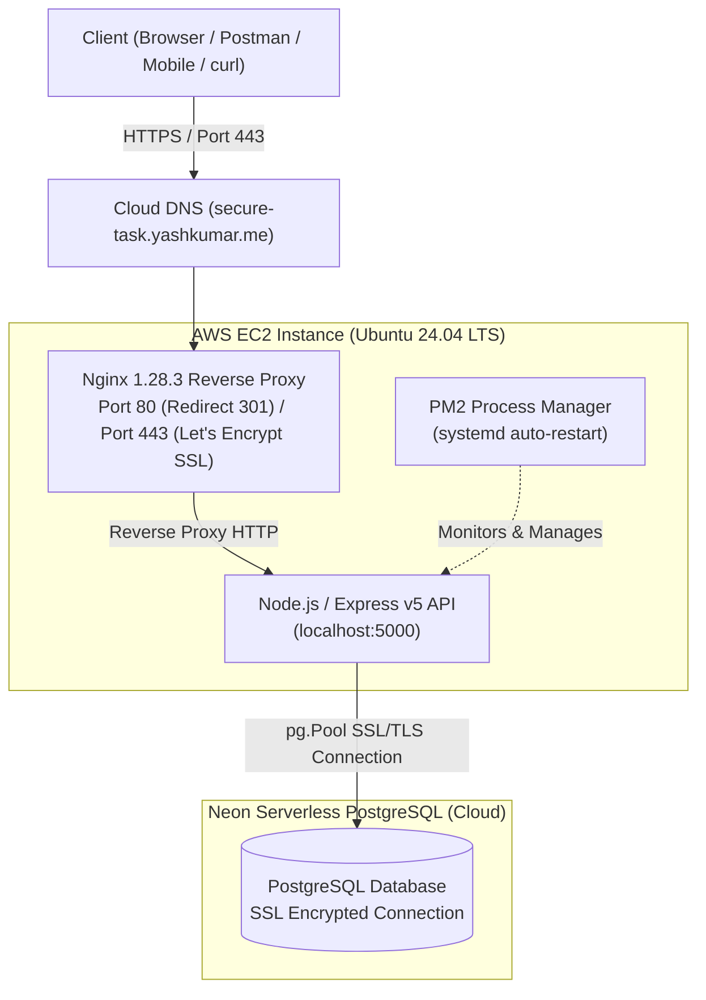
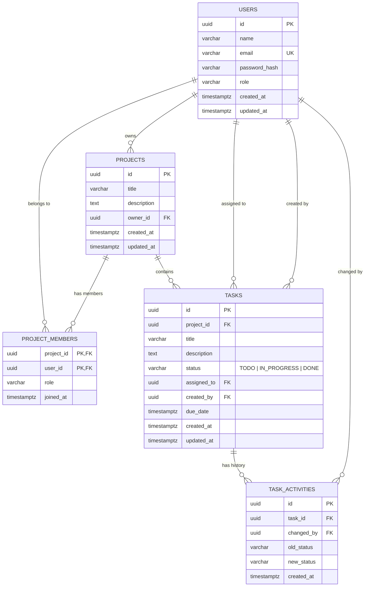

# TaskFlow — Secure Task Management API

> A robust, secure, and production-ready RESTful backend API for managing collaborative projects and tasks with multi-tenant access control, atomic status audit history, and automated testing.

Built as part of the Backend Developer Intern selection assignment at **Karya Saarthi**.

[](https://secure-task.yashkumar.me)
[](https://secure-task.yashkumar.me)
[](https://neon.tech)
[](https://nodejs.org)
[](tests/)
[](LICENSE)

---

## 🌐 Live Production Deployment on AWS

The API is fully deployed in production on **Amazon Web Services (AWS)** with an active custom domain and SSL/TLS certificate.

- **Base URL**: [`https://secure-task.yashkumar.me`](https://secure-task.yashkumar.me)
- **API Version 1**: [`https://secure-task.yashkumar.me/api/v1`](https://secure-task.yashkumar.me/api/v1)
- **API Interactive Docs**: [`https://secure-task.yashkumar.me/api/v1/docs`](https://secure-task.yashkumar.me/api/v1/docs)
- **Basic Health Check**: [`https://secure-task.yashkumar.me/health`](https://secure-task.yashkumar.me/health)
- **Deep Database Health Check**: [`https://secure-task.yashkumar.me/api/v1/health`](https://secure-task.yashkumar.me/api/v1/health)

### Production Infrastructure Stack:
- **Cloud Host**: Amazon Web Services (AWS) EC2 — Ubuntu 24.04 LTS
- **Reverse Proxy & Web Server**: Nginx `1.28.3`
  - Automatic HTTP &rarr; HTTPS redirection (301 Permanent Redirect)
  - Security headers, proxy buffering, and request proxying to local Express upstream
- **SSL / TLS Certificate**: Let's Encrypt via Certbot with automatic renewal daemon
- **Process Manager**: PM2 daemonized runtime for clustering, auto-reboot recovery (`systemd`), and zero-downtime reloads
- **Database**: Neon Serverless PostgreSQL with SSL connection pooling (`pg.Pool`)

---

## 🚀 Quick Start — Try the Live API

You can test the live endpoints directly from your terminal using `curl`:

### 1. Server Uptime & Basic Health Check
```bash
curl -i https://secure-task.yashkumar.me/health
```
```json
{
  "success": true,
  "message": "Server is healthy",
  "data": {
    "status": "UP",
    "uptime": "2850s",
    "timestamp": "2026-10-18T16:15:00.802Z"
  }
}
```

### 2. Deep Health Check (Live PostgreSQL Connectivity & Latency)
```bash
curl -i https://secure-task.yashkumar.me/api/v1/health
```
```json
{
  "success": true,
  "message": "API and Database are operational",
  "data": {
    "api": {
      "status": "UP",
      "uptime": "2850s",
      "timestamp": "2026-10-18T16:15:00.802Z"
    },
    "database": {
      "status": "CONNECTED",
      "latency": "28ms"
    }
  }
}
```

### 3. Register a New User
```bash
curl -X POST https://secure-task.yashkumar.me/api/v1/auth/register \
  -H "Content-Type: application/json" \
  -d '{
    "name": "Yash Kumar",
    "email": "yash.demo@example.com",
    "password": "SecurePassword@123"
  }'
```

### 4. Authenticate & Get JWT Token
```bash
curl -X POST https://secure-task.yashkumar.me/api/v1/auth/login \
  -H "Content-Type: application/json" \
  -d '{
    "email": "yash.demo@example.com",
    "password": "SecurePassword@123"
  }'
```

---

## 📮 Postman Collection

A complete, pre-configured Postman Collection is available directly in this repository:
[`postman_collection.json`](postman_collection.json)

### How to use:
1. Open **Postman** &rarr; Click **Import** &rarr; Select `postman_collection.json`.
2. The collection is pre-configured with:
   - `{{base_url}}`: `https://secure-task.yashkumar.me` (or `http://localhost:5000` for local dev)
   - Auto-saving JWT scripts: Registering or logging in automatically sets the `{{auth_token}}` variable!
   - 18 sample requests spanning Authentication, Project Management, Member Invitations, Task CRUD, Search/Filter/Pagination, and Audit Trails.

---

## Table of Contents
1. [Production Deployment Architecture](#production-deployment-architecture)
2. [Tech Stack](#tech-stack)
3. [Architecture & Key Technical Decisions](#architecture--key-technical-decisions)
4. [Database Schema & ER Diagram](#database-schema--er-diagram)
5. [API Endpoints Reference](#api-endpoints-reference)
6. [Automated Test Results](#automated-test-results)
7. [Local Setup & Installation](#local-setup--installation)

---

## 1. Production Deployment Architecture



---

## 2. Tech Stack

- **Runtime & Framework**: Node.js (v22), Express.js (v5)
- **Cloud Infrastructure**: AWS EC2, Nginx, Let's Encrypt Certbot, PM2
- **Database**: PostgreSQL (Hosted on Neon Serverless Postgres with SSL connection pool)
- **Security & Validation**: JWT (`jsonwebtoken`), Bcrypt (`bcrypt`), Zod (`zod`), Helmet (`helmet`), CORS (`cors`), Rate Limiting (`express-rate-limit`)
- **Testing & Tooling**: Jest, Supertest, Nodemon, ESLint

---

## 3. Architecture & Key Technical Decisions

### Layered Architecture
The codebase strictly adheres to the Separation of Concerns pattern:
```
Routes  -->  Middlewares  -->  Controllers  -->  Services  -->  PostgreSQL Pool (Neon)
```
- **Routes (`src/routes/`)**: Map URI patterns to controllers and apply route-level middlewares.
- **Middlewares (`src/middleware/`)**: Authentication (`authenticate`), Role guards (`requireProjectAccess`), Zod request validation (`validate`), and Centralized error handling (`errorHandler`).
- **Controllers (`src/controllers/`)**: Handle HTTP request extraction and formatted JSON responses.
- **Services (`src/services/`)**: Encapsulate all business logic, authorization rules, and SQL database transactions.
- **Database Config (`src/config/db.js`)**: Connection pool (`pg.Pool`) configured for resilient serverless connection reuse and SSL.

### Key Technical Decisions

1. **UUID Primary Keys vs Auto-Incrementing IDs**:
   - Auto-increment integers (`1, 2, 3`) expose ID enumeration vulnerabilities (IDOR).
   - Version 4 cryptographically random UUIDs (`uuid_generate_v4()`) prevent guessing resource identifiers.

2. **Atomic Status Transition & Activity History (Requirement 6)**:
   - When a task's status changes (`TODO` &rarr; `IN_PROGRESS` &rarr; `DONE`), both the task update and the audit history insert are wrapped in a single **PostgreSQL Transaction (`BEGIN ... COMMIT`)**. This guarantees ACID atomicity—either both succeed, or neither does.

3. **Multi-Tenant Access Isolation (Requirement 4)**:
   - Projects and tasks enforce strict boundaries. Even with a valid JWT token, users are restricted to projects where they are registered as `owner` or `member`. Unauthorized attempts return `403 Forbidden`.

4. **Security Best Practices**:
   - Passwords hashed with `bcrypt` (10 salt rounds with unique cryptographic salts).
   - JWT stateless authentication with configurable expiration.
   - Brute-force protection on authentication routes using `express-rate-limit`.
   - Security HTTP headers enabled via `helmet()`.
   - Centralized error handling mapping raw Postgres codes (e.g., `23505` duplicate key to `409 Conflict`, `22P02` to `400 Bad Request`) to avoid leaking database internals.

5. **Decoupled Server Entrypoint (`app.js` vs `server.js`)**:
   - Separating `app.js` from `server.js` enables Supertest to run fast integration tests in-memory without binding ports, preventing port collisions during parallel test runs.

---

## 4. Database Schema & ER Diagram



---

## 5. API Endpoints Reference

### Health Checks & Documentation (Requirement 9)
| Method | Endpoint | Description | Auth Required |
| :--- | :--- | :--- | :--- |
| `GET` | `/health` | Basic server uptime & status | None |
| `GET` | `/api/v1/health` | Deep health check (Live PostgreSQL connectivity & latency) | None |
| `GET` | `/api/v1/docs` | API documentation specification schema | None |
| `GET` | `/` | API welcome & service metadata | None |

### Authentication & User Profile (Requirement 1 & 4)
| Method | Endpoint | Description | Auth Required |
| :--- | :--- | :--- | :--- |
| `POST` | `/api/v1/auth/register` | Register new user account | None |
| `POST` | `/api/v1/auth/login` | Login user and issue JWT token | None |
| `GET` | `/api/v1/auth/me` | Get currently authenticated user profile | Bearer Token |

### Project Management (Requirement 2 & 4)
| Method | Endpoint | Description | Auth Required |
| :--- | :--- | :--- | :--- |
| `POST` | `/api/v1/projects` | Create a new project (creator becomes owner) | Bearer Token |
| `GET` | `/api/v1/projects` | List projects where user is owner or member | Bearer Token |
| `GET` | `/api/v1/projects/:id` | Get project details and team member list | Bearer Token |
| `PUT` | `/api/v1/projects/:id` | Update project title / description (owner only) | Bearer Token |
| `DELETE` | `/api/v1/projects/:id` | Delete project and cascade tasks (owner only) | Bearer Token |
| `POST` | `/api/v1/projects/:id/members` | Add a user to project by email | Bearer Token |

### Task Management & Status History (Requirements 3, 5 & 6)
| Method | Endpoint | Description | Auth Required |
| :--- | :--- | :--- | :--- |
| `POST` | `/api/v1/projects/:projectId/tasks` | Create task inside project and assign to user | Bearer Token |
| `GET` | `/api/v1/tasks` | Get tasks with filtering, sorting & pagination | Bearer Token |
| `GET` | `/api/v1/tasks/:id` | Get single task details | Bearer Token |
| `PUT` | `/api/v1/tasks/:id` | Update task details (title, description, assignee) | Bearer Token |
| `PATCH` | `/api/v1/tasks/:id/status` | Update task status & auto-log activity history | Bearer Token |
| `GET` | `/api/v1/tasks/:id/history` | Retrieve complete status change audit trail | Bearer Token |
| `DELETE` | `/api/v1/tasks/:id` | Delete task | Bearer Token |

#### Query Parameters for `GET /api/v1/tasks` (Requirement 5):
- `status`: Filter by status (`TODO` | `IN_PROGRESS` | `DONE`)
- `assignedTo`: UUID of assigned user
- `search`: Keyword search matching task title or description
- `sortBy`: `created_at` (default) | `due_date` | `status` | `title`
- `order`: `desc` (default) | `asc`
- `page`: Page number (default: `1`)
- `limit`: Items per page (default: `10`, max: `100`)

---

## 6. Automated Test Results (Requirement 8)

The test suite covers integration testing across all four core domains using **Jest** and **Supertest**:

```text
PASS tests/health.test.js
PASS tests/auth.test.js
PASS tests/projects.test.js
PASS tests/tasks.test.js

Test Suites: 4 passed, 4 total
Tests:       23 passed, 23 total
Snapshots:   0 total
Coverage:    > 77% all files, 100% routes, 95% validators
```

To run tests locally:
```bash
npm test
```

---

## 7. Local Setup & Installation

### Prerequisites
- Node.js >= 18
- PostgreSQL or Neon Database URL

### Steps
1. **Clone the repository**:
   ```bash
   git clone https://github.com/coder-Yash886/Secure-Task-Management-API-.git
   cd Secure-Task-Management-API-
   ```

2. **Install dependencies**:
   ```bash
   npm install
   ```

3. **Configure Environment Variables**:
   Copy `.env.example` to `.env`:
   ```bash
   cp .env.example .env
   ```
   Add your database credentials:
   ```env
   PORT=5000
   NODE_ENV=development
   DATABASE_URL=postgresql://<user>:<password>@<neon-hostname>/<database>?sslmode=require
   JWT_SECRET=your_jwt_secret_key_here
   JWT_EXPIRES_IN=7d
   ```

4. **Run Database Migrations**:
   ```bash
   npm run migrate
   ```

5. **Start Development Server**:
   ```bash
   npm run dev
   ```

6. **Run Automated Tests**:
   ```bash
   npm test
   ```

---

## 👨‍💻 Author

**Yash Kumar**
- GitHub: [@coder-Yash886](https://github.com/coder-Yash886)
- Live API: [https://secure-task.yashkumar.me](https://secure-task.yashkumar.me)
