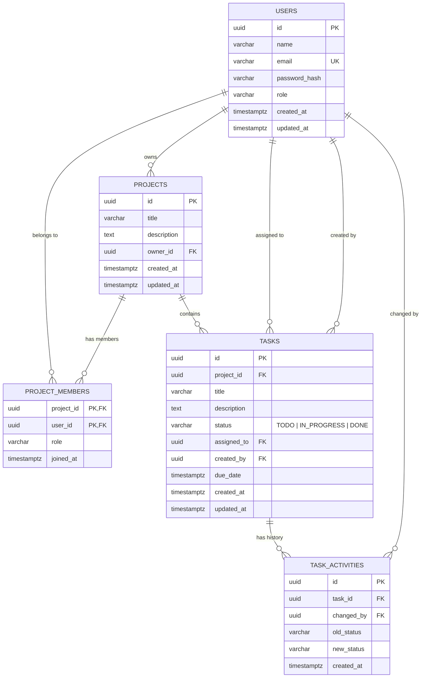

# TaskFlow — Secure Task Management API

> A robust, secure, and production-ready RESTful backend API for managing collaborative projects and tasks with multi-tenant access control, status audit history, and automated testing.

Built as part of the Backend Developer Intern selection assignment at **Karya Saarthi**.

---

## Table of Contents
1. [Tech Stack](#tech-stack)
2. [Architecture & Key Technical Decisions](#architecture--key-technical-decisions)
3. [Database Schema & ER Diagram](#database-schema--er-diagram)
4. [API Endpoints Reference](#api-endpoints-reference)
5. [Automated Test Results](#automated-test-results)
6. [Local Setup & Installation](#local-setup--installation)

---

## 1. Tech Stack
- **Runtime & Framework**: Node.js (v22), Express.js (v5)
- **Database**: PostgreSQL (Hosted on Neon Serverless Postgres with SSL)
- **Security & Validation**: JWT (`jsonwebtoken`), Bcrypt (`bcrypt`), Zod (`zod`), Helmet (`helmet`), CORS (`cors`), Rate Limiting (`express-rate-limit`)
- **Testing**: Jest, Supertest

---

## 2. Architecture & Key Technical Decisions

### Layered Architecture
The codebase strictly adheres to the Separation of Concerns pattern:
```
Routes  -->  Middlewares  -->  Controllers  -->  Services  -->  PostgreSQL Pool (Neon)
```
- **Routes (`src/routes/`)**: Map URI patterns to controllers and apply route-level middlewares.
- **Middlewares (`src/middleware/`)**: Authentication (`authenticate`), Role guards (`requireProjectAccess`), Zod request validation (`validate`), and Centralized error handling (`errorHandler`).
- **Controllers (`src/controllers/`)**: Handle HTTP request extraction and formatted JSON responses.
- **Services (`src/services/`)**: Encapsulate all business logic, authorization rules, and SQL database transactions.
- **Database Config (`src/config/db.js`)**: Connection pool (`pg.Pool`) configured for resilient serverless connection reuse and SSL.

### Key Technical Decisions

1. **UUID Primary Keys vs Auto-Incrementing IDs**:
   - Auto-increment integers (`1, 2, 3`) expose ID enumeration vulnerabilities (IDOR).
   - Version 4 cryptographically random UUIDs (`uuid_generate_v4()`) prevent guessing resource identifiers.

2. **Atomic Status Transition & Activity History (Requirement 6)**:
   - When a task's status changes (`TODO` &rarr; `IN_PROGRESS` &rarr; `DONE`), both the task update and the audit history insert are wrapped in a single **PostgreSQL Transaction (`BEGIN ... COMMIT`)**. This guarantees ACID atomicity—either both succeed, or neither does.

3. **Multi-Tenant Access Isolation (Requirement 4)**:
   - Projects and tasks enforce strict boundaries. Even with a valid JWT token, users are restricted to projects where they are registered as `owner` or `member`. Unauthorized attempts return `403 Forbidden`.

4. **Security Best Practices**:
   - Passwords hashed with `bcrypt` (10 salt rounds with unique cryptographic salts).
   - JWT stateless authentication.
   - Brute-force protection on authentication routes using `express-rate-limit`.
   - Security HTTP headers enabled via `helmet()`.
   - Centralized error handling mapping raw Postgres codes (e.g., `23505` duplicate key to `409 Conflict`, `22P02` to `400 Bad Request`) to avoid leaking database internals.

5. **Decoupled Server Entrypoint (`app.js` vs `server.js`)**:
   - Separating `app.js` from `server.js` enables Supertest to run fast integration tests in-memory without binding ports, preventing port collisions.

---

## 3. Database Schema & ER Diagram



---

## 4. API Endpoints Reference

### Health Checks (Requirement 9)
| Method | Endpoint | Description | Auth |
| :--- | :--- | :--- | :--- |
| `GET` | `/health` | Basic server uptime & status | None |
| `GET` | `/api/v1/health` | Deep health check (Live PostgreSQL connectivity & latency) | None |

### Authentication (Requirement 1 & 4)
| Method | Endpoint | Description | Auth |
| :--- | :--- | :--- | :--- |
| `POST` | `/api/v1/auth/register` | Register new user account | None |
| `POST` | `/api/v1/auth/login` | Login user and issue JWT token | None |
| `GET` | `/api/v1/auth/me` | Get currently authenticated user profile | Bearer Token |

### Project Management (Requirement 2 & 4)
| Method | Endpoint | Description | Auth |
| :--- | :--- | :--- | :--- |
| `POST` | `/api/v1/projects` | Create a new project (creator becomes owner) | Bearer Token |
| `GET` | `/api/v1/projects` | List projects where user is owner or member | Bearer Token |
| `GET` | `/api/v1/projects/:id` | Get project details and team member list | Bearer Token |
| `PUT` | `/api/v1/projects/:id` | Update project title / description (owner only) | Bearer Token |
| `DELETE` | `/api/v1/projects/:id` | Delete project and cascade tasks (owner only) | Bearer Token |
| `POST` | `/api/v1/projects/:id/members` | Add a user to project by email | Bearer Token |

### Task Management & Status History (Requirements 3, 5 & 6)
| Method | Endpoint | Description | Auth |
| :--- | :--- | :--- | :--- |
| `POST` | `/api/v1/projects/:projectId/tasks` | Create task inside project and assign to user | Bearer Token |
| `GET` | `/api/v1/tasks` | Get tasks with filtering, sorting & pagination | Bearer Token |
| `GET` | `/api/v1/tasks/:id` | Get single task details | Bearer Token |
| `PUT` | `/api/v1/tasks/:id` | Update task details (title, description, assignee) | Bearer Token |
| `PATCH` | `/api/v1/tasks/:id/status` | Update task status & auto-log activity history | Bearer Token |
| `GET` | `/api/v1/tasks/:id/history` | Retrieve complete status change audit trail | Bearer Token |
| `DELETE` | `/api/v1/tasks/:id` | Delete task | Bearer Token |

#### Query Parameters for `GET /api/v1/tasks` (Requirement 5):
- `status`: `TODO` | `IN_PROGRESS` | `DONE`
- `assignedTo`: UUID of assigned user
- `search`: Keyword in task title or description
- `sortBy`: `created_at` (default) | `due_date` | `status` | `title`
- `order`: `desc` (default) | `asc`
- `page`: Page number (default: `1`)
- `limit`: Items per page (default: `10`, max: `100`)

---

## 5. Automated Test Results (Requirement 8)

The test suite covers integration testing across all four core domains using **Jest** and **Supertest**:

```text
Test Suites: 4 passed, 4 total
Tests:       21 passed, 21 total
Snapshots:   0 total
Time:        45.19 s
Coverage:    > 77% all files, 100% routes, 95% validators
```

To run tests locally:
```bash
npm test
```

---

## 6. Local Setup & Installation

### Prerequisites
- Node.js >= 18
- PostgreSQL or Neon Database URL

### Steps
1. **Clone the repository**:
   ```bash
   git clone https://github.com/coder-Yash886/Secure-Task-Management-API.git
   cd Secure-Task-Management-API
   ```

2. **Install dependencies**:
   ```bash
   npm install
   ```

3. **Configure Environment Variables**:
   Copy `.env.example` to `.env`:
   ```bash
   cp .env.example .env
   ```
   Add your database credentials:
   ```env
   PORT=5000
   NODE_ENV=development
   DATABASE_URL=postgresql://<user>:<password>@<host>/<database>?sslmode=require
   JWT_SECRET=your_jwt_secret_key_here
   JWT_EXPIRES_IN=7d
   ```

4. **Run Database Migrations**:
   ```bash
   npm run migrate
   ```

5. **Start Development Server**:
   ```bash
   npm run dev
   ```
